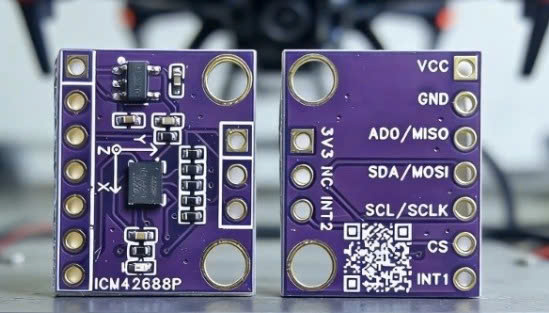
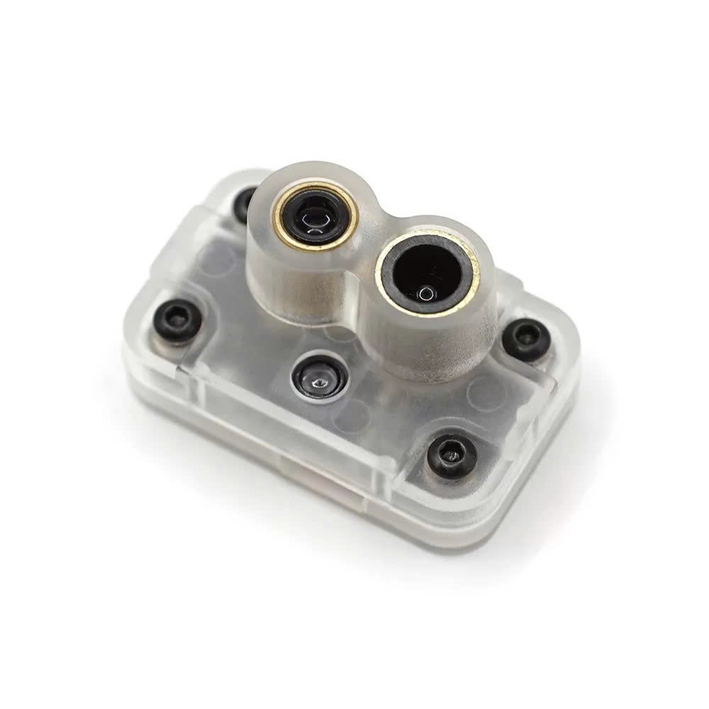
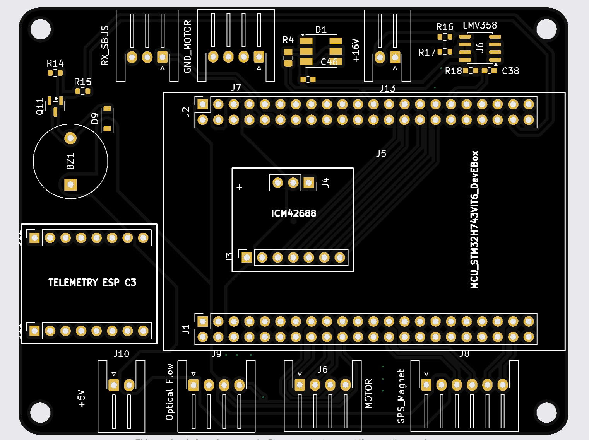
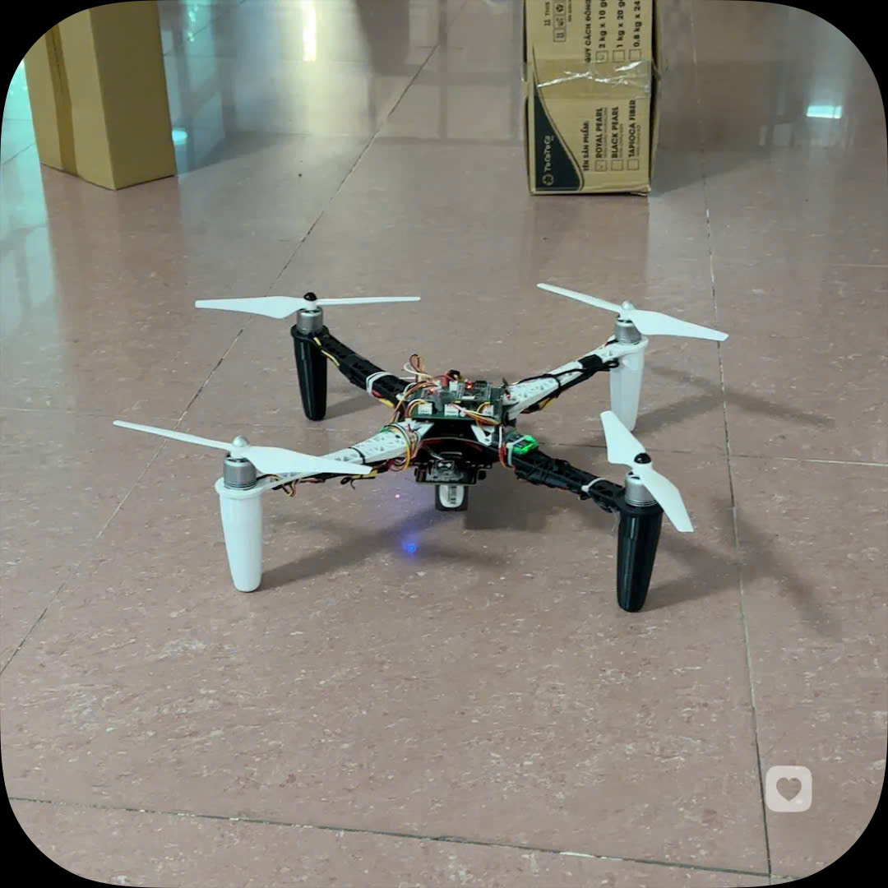

# Đồ án chuyên ngành Cơ điện tử: Thiết kế chế tạo quadcopter và xây dựng thuật toán giữ độ cao, vị trí cho quadcopter trong môi trường khép kín

Kho lưu trữ (Repository) này chứa toàn bộ tài liệu, file thiết kế mạch in (PCB), mã nguồn điều khiển và dữ liệu tính toán của dự án.

---

## 🎯 Nhiệm vụ đảm nhiệm

### 1. Tính toán tải trọng và lực nâng
Trước khi tiến hành lựa chọn linh kiện và thiết kế mạch, hệ thống được tính toán kỹ lưỡng để đảm bảo khả năng bay ổn định trong môi trường khép kín:
- **Tối ưu tải trọng:** Xác định tổng trọng lượng dự kiến của hệ thống (khung S500, pin 5300mAh, mạch điều khiển trung tâm, cụm cảm biến...).
- **Phân tích lực nâng:** Đánh giá và tính toán lực đẩy (Thrust) thực tế tạo ra từ cấu hình tổ hợp: Động cơ Phantom 3 850KV + Cánh quạt 9450 + Nguồn điện 14.8V (Pin 4S). 
- **Mục tiêu:** Đạt được tỷ lệ lực đẩy/trọng lượng (Thrust-to-Weight Ratio) tối ưu, nhằm đảm bảo drone cất cánh an toàn, bay ổn định và xác định giới hạn tải trọng dư thừa.

---

### 2. Lựa chọn linh kiện và Cấu hình phần cứng
Hệ thống phần cứng được nâng cấp và tích hợp trên bo mạch chủ tự thiết kế (**SPIDER_H7_FC**) sử dụng vi điều khiển hiệu năng cao STM32H743 kết hợp cùng cảm biến quán tính ICM42688. Dưới đây là bảng chi tiết các module chính:

| Phân loại | Tên linh kiện | Chức năng chính | Hình ảnh minh họa |
| :--- | :--- | :--- | :---: |
| **Bộ điều khiển trung tâm** | **Kit DevEBox STM32H743VIT6** | Vi điều khiển trung tâm (Flight Controller), xử lý thuật toán điều khiển bay và lọc nhiễu tốc độ cao. |  |
| **Cảm biến & Định vị** | **IMU ICM-42688-P** | Đo lường quán tính 6 trục (gia tốc và vận tốc góc) độ chính xác cao. |  |
| | **Optical Flow MTF-01P** | Cảm biến quang học kết hợp LiDAR hỗ trợ đo khoảng cách và giữ vị trí tầm thấp trong nhà. |  |
| | **GPS & La bàn GEP-M10-DI** | Thu thập dữ liệu tọa độ và hướng từ trường (Magnetometer). |  |
| **Giao tiếp & Giám sát** | **Module ESP32-C3** | Truyền nhận dữ liệu Telemetry không dây để giám sát thông số bay theo thời gian thực. | |
| | **Bộ Tay điều khiển (Tx/Rx)** | Giao tiếp sóng RF (chuẩn SBUS) để điều khiển drone từ xa. | |
| **Hệ thống Động lực** | **Khung (Frame) S500** | Khung giá đỡ chịu lực chính cho toàn bộ hệ thống drone. | |
| | **Động cơ Phantom 3 850KV** | Động cơ không chổi than (Brushless Motor) tạo lực quay. | |
| | **Cánh quạt 9450** | Tạo lực nâng đẩy hệ thống khi kết hợp với động cơ. | |
| **Năng lượng** | **Pin LiPo Ovonic 4S 5300mAh** | Cấp nguồn năng lượng chính (14.8V) cho toàn bộ cấu hình. | |

---

### 3. Thiết kế mạch điều khiển trung tâm (PCB - SPIDER_H7_FC)
Để tối ưu hóa không gian, giảm nhiễu dây dẫn và tăng độ tin cậy khi rung động, bo mạch mở rộng (Carrier Board) **SPIDER_H7_FC** được thiết kế chuyên biệt để kết nối tất cả các ngoại vi với kit **STM32H743VIT6 DevEBox**:

* **Giao tiếp chuẩn công nghiệp (JST Connectors):** Tích hợp sẵn các cổng cắm chống ngược cực cho từng ngoại vi riêng biệt:
  * `RX_SBUS`: Cổng nhận tín hiệu điều khiển từ tay cầm.
  * `MOTOR` & `GND_MOTOR`: 4 kênh xuất xung PWM điều khiển tốc độ động cơ (ESC).
  * `Optical Flow`: Cổng giao tiếp UART cho cảm biến MTF-01P.
  * `GPS_Magnet`: Cổng kết nối module định vị và la bàn từ.
  * `TELEMETRY ESP C3`: Đế cắm trực tiếp module ESP32-C3 phục vụ truyền dữ liệu không dây.
* **Hệ thống nguồn & Bảo vệ:**
  * Đầu vào nguồn `+16V` (từ pin 4S) và đường nguồn ổn áp `+5V` nuôi cảm biến/vi điều khiển.
  * Tích hợp mạch đo điện áp pin (sử dụng Op-amp `LMV358` và cầu phân áp) để cảnh báo pin yếu.
* **Tiện ích tích hợp:** Trang bị còi báo trạng thái (`BZ1` - Buzzer) và đế cắm tối ưu chống nhiễu cơ khí cho module IMU `ICM42688`.

  <table>
    <tr>
      <td align="center">
         
        <b>Mặt trên (Top Layer) - Bố trí linh kiện và cổng kết nối</b>
      </td>
      <td align="center">
         
        <b>Mặt dưới (Bottom Layer) - Đi dây tín hiệu và Silkscreen</b>
      </td>
    </tr>
  </table>

---

### 4. Hình ảnh thực tế của Drone sau khi lắp ráp

  

