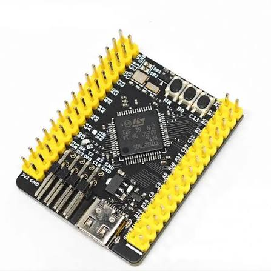
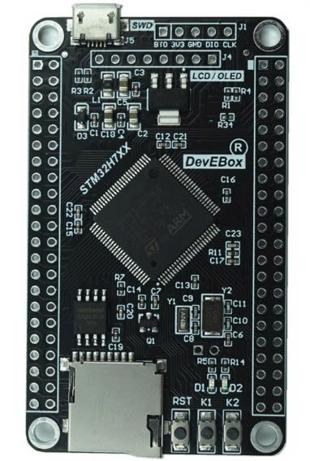
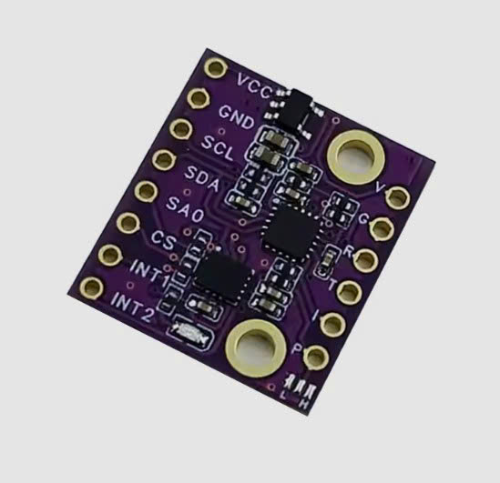
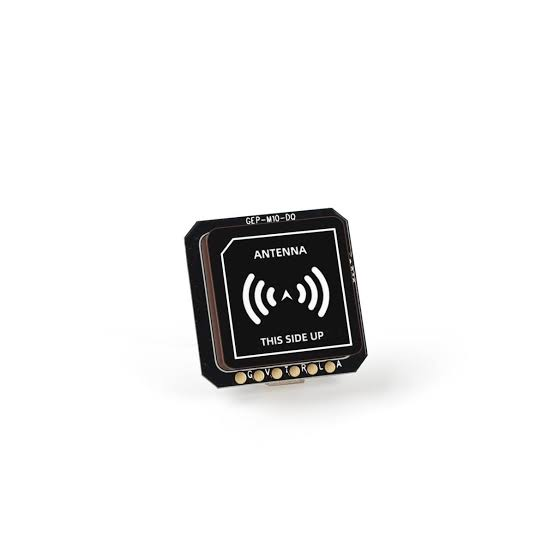
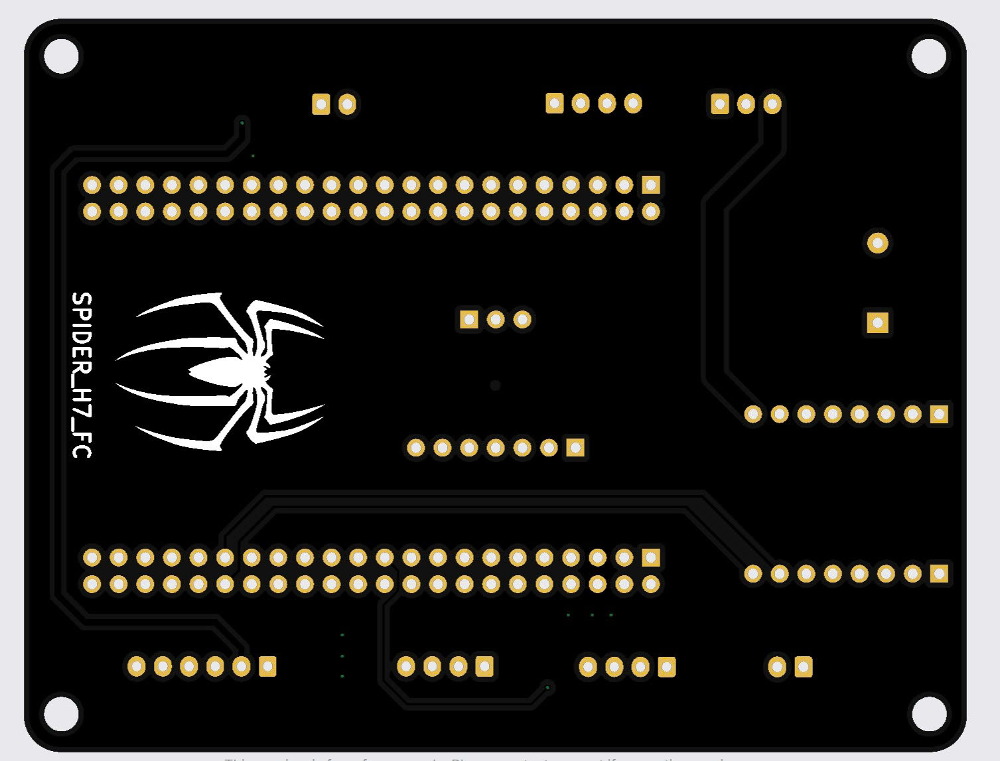
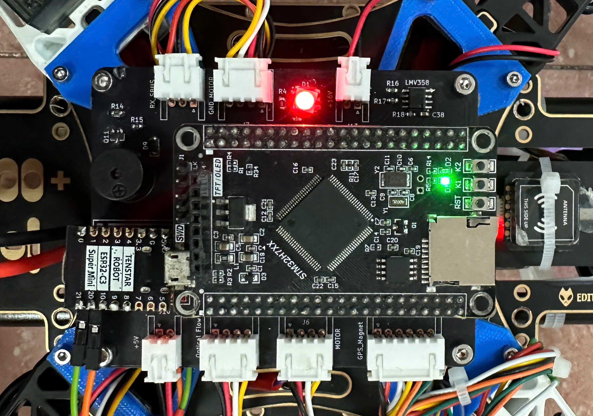
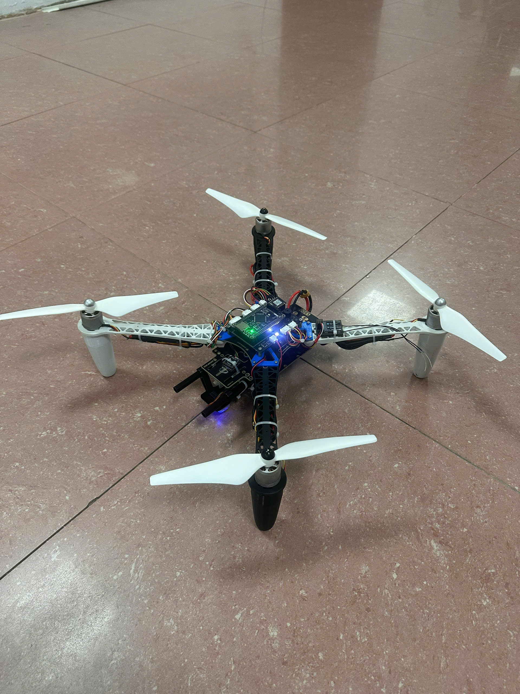

# Đồ án chuyên ngành Cơ điện tử: Thiết kế chế tạo quadcopter và xây dựng thuật toán giữ độ cao, vị trí cho quadcopter trong môi trường khép kín

Kho lưu trữ (Repository) này chứa các tài liệu, mã nguồn và dữ liệu tính toán của dự án (bao gồm cả phiên bản phần cứng nền tảng `drone_stm32f405rgt6` và phiên bản nâng cấp `drone_stm32h743vit6`).

## 🎯 Nhiệm vụ đảm nhiệm

### 1. Tính toán tải trọng và lực nâng
Trước khi tiến hành lựa chọn linh kiện, hệ thống cần được tính toán kỹ lưỡng để đảm bảo khả năng bay ổn định:
- **Tối ưu tải trọng:** Xác định tổng trọng lượng dự kiến của hệ thống (khung S500, pin 5300mAh, vi điều khiển, cảm biến...).
- **Phân tích lực nâng:** Đánh giá và tính toán lực đẩy (Thrust) thực tế tạo ra từ cấu hình tổ hợp: Động cơ Phantom 3 850KV + Cánh quạt 9450 + Nguồn điện 14.8V (Pin 4S). 
- **Mục tiêu:** Đạt được tỷ lệ lực đẩy/trọng lượng (Thrust-to-Weight Ratio) tối ưu, nhằm đảm bảo drone cất cánh an toàn, bay ổn định và xác định được giới hạn tải trọng dư thừa nếu gắn thêm thiết bị (như camera, gimbal).

### 2. Lựa chọn linh kiện và Tích hợp phần cứng
Dựa trên các thông số tính toán lực nâng và tải trọng ở trên, hệ thống phần cứng được chốt cấu hình và tiến hành mua sắm, lắp ráp. Dưới đây là bảng chi tiết các module được sử dụng:

| Phân loại | Tên linh kiện | Chức năng chính | Hình ảnh minh họa |
| :--- | :--- | :--- | :---: |
| **Bộ điều khiển trung tâm** | **Kit WeAct STM32F405RGT6** *(Phiên bản 1)* | Vi điều khiển trung tâm (Flight Controller) giai đoạn đầu, xử lý thuật toán bay cơ bản. |  |
| | **Kit DevEBox STM32H743VIT6** *(Nâng cấp)* | Vi điều khiển trung tâm hiệu năng cao (480MHz), mở rộng tài nguyên tính toán. |  |
| **Cảm biến & Định vị** | **IMU BMI323 / ICM-42688** | Đo lường quán tính (gia tốc và góc quay); nâng cấp lên **ICM-42688** trên bản mạch mới để giảm nhiễu. |  |
| | **Optical Flow MTF-01P** | Cảm biến quang học hỗ trợ giữ vị trí tầm thấp. |  |
| | **GPS GEP-M10-DI** | Module La bàn và định vị vệ tinh. |  |
| **Giao tiếp & Telemetry** | **Module ESP32-C3** *(Nâng cấp)* | Truyền nhận dữ liệu Telemetry không dây theo thời gian thực trên bo mạch mới. | |
| **Hệ thống Động lực** | **Khung (Frame) S500** | Khung giá đỡ chịu lực cho toàn bộ hệ thống drone. | |
| | **Động cơ Phantom 3 850KV** | Động cơ không chổi than (Brushless Motor) tạo lực quay. | |
| | **Cánh quạt 9450** | Tạo lực nâng đẩy hệ thống khi kết hợp với động cơ. | |
| **Năng lượng & Giao tiếp** | **Pin LiPo Ovonic 4S 5300mAh** | Cấp nguồn năng lượng (14.8V) cho toàn bộ cấu hình. | |
| | **Bộ Tay điều khiển (Tx/Rx)** | Giao tiếp sóng RF để điều khiển drone từ xa. | |

### 3. Nâng cấp phần cứng & Thiết kế mạch in (PCB - SPIDER_H7_FC)
Để đáp ứng yêu cầu xử lý các thuật toán điều khiển phức tạp, giảm nhiễu dây cắm và tăng độ ổn định cơ khí, hệ thống được nâng cấp từ **STM32F405RGT6** (đấu nối dây rời) sang **STM32H743VIT6** tích hợp trên bo mạch chủ tự thiết kế **SPIDER_H7_FC**:

- **Lý do nâng cấp:** Tận dụng xung nhịp cao (480MHz) và tập lệnh DSP/FPU mạnh mẽ của dòng STM32H7 để chạy bộ lọc Kalman và vòng lặp điều khiển tần số cao mượt mà hơn, đồng thời khắc phục tình trạng lỏng dây tín hiệu khi drone rung động.
- **Đặc điểm thiết kế mạch SPIDER_H7_FC:**
  - **Chuẩn hóa cổng kết nối:** Sử dụng các jack cắm chống ngược cực cho từng ngoại vi riêng biệt: `RX_SBUS` (tay điều khiển), `MOTOR` & `GND_MOTOR` (4 kênh ESC), `Optical Flow` (MTF-01P), và `GPS_Magnet` (GEP-M10-DI).
  - **Tích hợp cảm biến & Telemetry:** Bố trí đế cắm trực tiếp cho cảm biến quán tính **ICM-42688** và module truyền dữ liệu không dây **ESP32-C3** (`TELEMETRY ESP C3`).
  - **Nguồn & Giám sát:** Hỗ trợ đầu vào nguồn pin 4S (`+16V`), đường nguồn ổn áp `+5V`, tích hợp mạch Op-amp `LMV358` đo điện áp pin và còi báo trạng thái (`BZ1`).

  <table>
    <tr>
      <td align="center">
         
        <b>Mặt trên (Top Layer)</b>
      </td>
      <td align="center">
         
        <b>Mặt dưới (Bottom Layer)</b>
      </td>
    </tr>
    <tr>
      <td colspan="2" align="center">
         
        <b>Bo mạch SPIDER_H7_FC thực tế (bản nâng cấp)</b>
      </td>
    </tr>
  </table>

### 4. Hình ảnh thực tế của Drone sau khi lắp ráp

  <table>
    <tr>
      <td align="center">
         
        <b>Drone Ver 1 (STM32F405RGT6 - đấu nối dây rời)</b>
      </td>
      <td align="center">
         
        <b>Drone Ver 2 (SPIDER_H7_FC - bản nâng cấp)</b>
      </td>
    </tr>
  </table>

